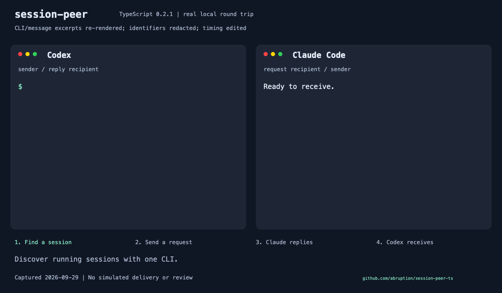

<div align="center">

# session-peer (TypeScript)

[](https://www.npmjs.com/package/session-peer)
[](https://www.npmjs.com/package/session-peer)
[](https://github.com/abruption/session-peer-ts/actions/workflows/ci.yml)
[](https://www.npmjs.com/package/session-peer)
[](LICENSE)

<sub>npm のダウンロード統計はパッケージ公開より遅れて反映される場合があります。</sub>

[English](README.md) | [한국어](README.ko.md) | [日本語](README.ja.md) | [简体中文](README.zh-CN.md)

**実行中の Claude Code・Codex セッションを見つけ、ローカルまたは SSH でメッセージを送信します。**
Python 不要の Node.js クライアントです。パッケージ名とコマンド名は `session-peer` です。

</div>

<!-- docs-contract: stable-release-source; package=session-peer; bin=session-peer; node=22.13+/24; python-reference=1.1.0 -->

**ドキュメントとソースのバージョン: 0.7.0。**

Windows では Codex への送信と dry-run はキューに登録する前に停止します。クラウドのストレージポリシーを確認できない環境でも、通常の Codex 送信は停止します。[Codex のストレージ検証規則](docs/api.md#codex-storage-configuration)と[配信観測の範囲](docs/api.md#local-delivery-observation--72)を参照してください。

<a id="demo"></a>

## デモ



npm 0.2.1 でローカルの要求と明示的な `ACK DEMO-READY` の返信を確認しました。識別情報を隠し、表示タイミングを調整して、CLI の出力とメッセージの抜粋を再現したものです。画面録画ではありません。提出だけでは ACK を意味しません。

インストール後、一覧で送信先のセッションを選び、`CLAUDE_PID` をその PID に置き換えてください。

```sh
session-peer list --agent claude --json
session-peer send --to CLAUDE_PID --message 'API の契約を確認して返信してください。' --dry-run --json
```

`--dry-run` は送信せずに検証します。実際に送るときは同じコマンドから
`--dry-run` を外して一度実行してください。受領確認が必要な場合は、メッセージで返信を依頼してください。
**`posted` / `queued` は、受信箱への書き込みまたはキューへの登録を示します。受信側での処理や ACK は別途確認してください。** `unknown`
(`submitted:null`)、返信がないこと、対象の終了を理由に自動再送しないでください。
`consumptionConfirmed` は常に false です。返信は受信側 TUI で確認します。

<a id="quick-start"></a>

## クイックスタート

macOS/Linux/Windows、**Node 22.x の 22.13 以降または 24.x**、環境に合った
ビルド済みのネイティブ依存パッケージ（x64/arm64）が必要です。Claude は実行中 TUI の inbox、
Codex は CLI と検証可能な writer が必要です(macOS/Linux は `lsof`・`ps` も必要)。
SSH は既存の鍵・ホスト信頼設定と両端の**同じバージョンの TypeScript クライアント**を
必要とします。OS ごとの要件と、非アクティブな Codex セッションのキューに登録する条件はガイドを参照してください。

<a id="install"></a>

### インストール

[Python CLI](https://github.com/abruption/session-peer)も同じコマンド名を使います。
インストール前に macOS/Linux では `type -a session-peer`、PowerShell では
`Get-Command session-peer -All` で PATH を確認してください。利用する実装を選び、
別の管理ツールのファイルを `--force` で上書きしないでください。

**0.7.0 のインストール:** npm の導入・更新例を実行する前に、レジストリで公開状況と選択したリリースを確認してください。利用できない場合は[レビュー済みソースビルド](docs/guide.ja.md#ソースからビルド)を使います。

```sh
npm view session-peer@0.7.0 version dist.integrity
npm install --global --ignore-scripts session-peer@0.7.0
session-peer --version
```

期待する出力: `session-peer 0.7.0 (typescript)`。分離インストール・ソースビルド・
Windows・削除の手順は以下の詳細ガイドを参照してください。

任意の `sp` 短縮名は 0.3.0 以降に含まれ（0.2.1 以前にはありません）、自動では有効になりません。
[明示的な有効化・衝突・解除(英語)](docs/shorthand.md)を参照してください。

<a id="update"></a>

### 更新

npm で導入したクライアントは npm で更新します。タグと対象バージョンを確認してから
更新先のバージョンを指定してください。以下は、npm でインストールした旧版を 0.7.0 に更新する例です。
CLI は更新をインストールせず、`session-peer update --check` は確認のみ行います。

```sh
npm view session-peer dist-tags
npm install --global --ignore-scripts session-peer@0.7.0
session-peer --version
```

連携スキルは、ガイドに記載されたコミットを使って別途インストール・更新してください。

<!-- Preserve links to the former detailed sections; their contents are in the guide. -->
<a id="機能と範囲"></a>
<a id="020-の統合一覧"></a>
<a id="020-cli-の使いやすさ"></a>
<a id="必要条件"></a>
<a id="インストール"></a>
<a id="ソースからビルド"></a>
<a id="既存インストールとの共存"></a>
<a id="使い方"></a>
<a id="ssh"></a>
<a id="返信"></a>
<a id="成功の意味と安全性"></a>
<a id="開発と検証"></a>
<a id="npm-リリース"></a>
<a id="関連プロジェクト"></a>
<a id="020-の読み取り専用診断"></a>
<a id="エージェントスキルの明示的な導入"></a>

<a id="docs"></a>

## ドキュメント

- [ユーザーガイド](docs/guide.ja.md) — CLI オプション、セッションの検索、Codex のホームディレクトリ、SSH、返信、インストール、スキル設定。
- [API リファレンス(英語)](docs/api.md).
- [互換性・移行・機能計画](PARITY.md).
- [リリース証拠・プラットフォーム検証](VALIDATION.md).
- [開発・貢献](CONTRIBUTING.md).
- [リリース手順](RELEASING.md).
- [0.4.0 handoff 設計と実装の範囲](PARITY.md#handoff-v1-design-candidate--69).
- [private handoff CLI と制限](docs/api.md#unreleased-opt-in-handoff-cli--040-work).

<a id="license"></a>

## ライセンス

[MIT ライセンス](LICENSE)で公開しています。

<a id="support-and-security"></a>

## サポートとセキュリティ

利用上の質問と再現可能な不具合は[イシュー](https://github.com/abruption/session-peer-ts/issues)へ。
脆弱性は[非公開報告](https://github.com/abruption/session-peer-ts/security/advisories/new)または
[support@abruption.dev](mailto:support@abruption.dev?subject=%5Bsession-peer-ts%5D%20Security)へ送ってください。
[SECURITY.md](SECURITY.md)を確認し、認証情報・メッセージ・個人のパスを除去してください。
